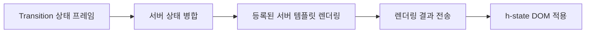
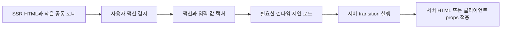

# 서버 렌더링 슬롯과 Lithent 아일랜드 — 설계 아이디어

작성일: 2026-10-12
상태: Idea / Draft — 기능 미구현, API와 프로토콜은 제안

요구사항은 [REQUIREMENTS.md](./REQUIREMENTS.md), 구현 후보는
[IMPLEMENT.md](./IMPLEMENT.md), 검증 기준은
[MANUAL_TEST_CHECKLIST.md](./MANUAL_TEST_CHECKLIST.md)에 기록한다.

## 1. 현재 구현의 기준선

| 항목 | 현재 동작 | 근거 |
| --- | --- | --- |
| 초기 페이지 | 상태를 서버 템플릿으로 렌더링해 HTML 응답을 보낸다. | [routeHandler.ts](../../engine/server/routeHandler.ts), [ssrRenderer.ts](../../engine/server/ssrRenderer.ts) |
| 초기 클라이언트 | 초기 상태가 있는 각 슬롯을 hydrate한다. | [stateSurface.ts](../../engine/client/stateSurface.ts) |
| 템플릿 로딩 | 모든 라우트 템플릿을 `eager: true`로 등록한다. | [auto.ts](../../engine/client/templates/auto.ts) |
| 플러그인 로딩 | Prism, 목차, 채팅 스크롤을 공통 entry에서 가져온다. | [client/main.ts](../../client/main.ts) |
| 브리지 로딩 | Lithent 브리지와 디버그 오버레이를 정적으로 가져온다. | [engine/client/main.ts](../../engine/client/main.ts) |
| 액션 | 공통 click/submit 리스너가 `data-action`을 읽어 transition을 호출한다. | [actionDelegation.ts](../../engine/client/actionDelegation.ts) |
| transition 응답 | 서버가 NDJSON을 쓰고 클라이언트는 스트림 파서로 읽는다. | [server/index.ts](../../engine/server/index.ts), [ndjson.ts](../../engine/shared/ndjson.ts) |
| 복잡한 컴포넌트 | 템플릿 타입은 Lithent 컴포넌트이며 `mount`도 등록할 수 있다. | [templateRegistry.ts](../../engine/shared/templateRegistry.ts), [lithentBridge.test.ts](../../engine/client/lithentBridge.test.ts) |

현재의 비용은 크게 세 가지다.

1. 현재 페이지와 무관한 템플릿·플러그인을 가져오는 비용.
2. 이미 SSR한 영역의 템플릿을 브라우저에서 다시 실행하는 비용.
3. SSR HTML과 함께 초기 상태 JSON을 전달하고 파싱하는 비용.

이 비용은 각각 코드 분리, 서버 전용 슬롯, 초기 데이터 분리로 검토한다.
현재 checkout에는 `node_modules/`와 `dist/`가 없어 실제 production bundle은 측정하지 않았다.

## 2. RSC에서 가져올 효과와 아일랜드의 역할

목표는 서버 전용 렌더링 코드와 의존성을 브라우저 bundle에서 제외하는 것이다.
RSC/Flight와 같은 프로토콜을 구현하는 것이 아니라 StateSurface의 슬롯에 이 원칙을 적용한다.

React의 `'use client'`는 모듈과 해당 의존성의 클라이언트 경계를 표시한다.
`'use server'`는 클라이언트에서 호출할 수 있는 서버 함수를 표시하며,
Server Component 자체를 표시하는 지시문은 아니다.

RSC도 작은 컴포넌트 단위의 경계와 서버에서 렌더링한 children 전달을 지원한다.
따라서 아일랜드라는 이유만으로 항상 더 세밀하거나 빠르다고 단정하지 않는다.
StateSurface의 이점은 `<h-state>`와 선언적 액션을 이용해 작은 경계를 명시하고,
그 경계를 독립적으로 로드·활성화하기 쉬운 작성 모델을 제공하는 데 있다.

특히 `data-action` 기반 서버 액션은 클릭 가능한 UI에도 영역 전체의 템플릿 JS를
요구하지 않을 수 있다. 공통 이벤트 처리와 서버 응답 적용 런타임은 여전히 필요하다.

## 3. 독립적으로 선택할 세 축

### 3.1 렌더링 모드

다음 이름은 개념을 설명하기 위한 제안이며 현재 API에 존재하지 않는다.

| 모드 | 초기 표시 | 인페이지 업데이트 | 브라우저에 필요한 코드 |
| --- | --- | --- | --- |
| `static` | 서버에서 생성한 HTML | 방문 중 콘텐츠 유지 | 해당 템플릿 JS 없음 |
| `server` | 서버에서 생성한 HTML | 서버가 렌더링한 결과를 슬롯에 적용 | 액션·전송·DOM 적용 런타임 |
| `client` | 가능한 경우 SSR한 HTML | 서버 props와 로컬 상태로 Lithent가 갱신 | 해당 컴포넌트와 필요한 Lithent 기능 |

`static`은 방문 중 콘텐츠를 갱신하지 않는다는 의미다.
언어 전환으로 내용이 바뀌는 가이드 본문은 `server`에 해당한다.
`<details>` 등 HTML 기본 동작은 컴포넌트 JS 없이 사용할 수 있다.
하나의 페이지에서 세 모드를 함께 사용한다.

### 3.2 응답 방식

단건/스트리밍은 렌더링 모드와 별개다.

- 단건: 검색, 저장처럼 결과를 한 번 전달한다.
- 스트리밍: 채팅, 진행 상황처럼 여러 결과를 순서대로 전달한다.
- 서버 HTML 결과와 클라이언트 props 모두 단건 또는 스트리밍으로 전달할 수 있게 검토한다.

현재도 다음 transition은 데이터 업데이트를 한 번만 수행한다.

```ts
yield { type: 'state', states: result };
yield { type: 'done' };
```

[switchLang.ts](../../routes/_shared/transitions/switchLang.ts)가 실제 예다.
이 경우 결과 업데이트는 한 번이지만 전송 형식은 NDJSON이다.
스트리밍도 요청 하나에 대한 HTTP 응답 하나이며, 여기서 단건은 결과를 점진적으로 보내지
않는 방식과 일반 JSON 응답 모드를 뜻한다.

성공한 transition을 일반 `application/json`으로 응답하는 전용 모드는 아직 없다.
현재 파서는 Content-Type 분기 없이 NDJSON을 읽으므로, 개행 없는 한 줄짜리 StateFrame JSON도
응답 종료 시 파싱할 수 있다. 일반 JSON의 배열·envelope·여러 줄 표현을 지원하는 계약은 아니다.

향후 JSON 응답은 Content-Type으로 명시적으로 읽고, 스트림 경로와 동일한 프레임 적용
파이프라인에 연결하는 방향을 검토한다. 응답 envelope, 완료·오류 의미, 최종 상태 반환과
프레임 배열 반환 중 무엇을 지원할지는 DC-10에서 결정한다.
일반 async 함수의 반환값을 transition으로 등록하는 작성 API도 아직 미구현이다.

### 3.3 활성화 시점

초기 로딩, 사용자 이벤트, 화면 진입, 명시적 활성화 등은 렌더링 모드와 별도로 결정한다.
예를 들어 에디터는 focus 전에 활성화가 필요하고, 자동 스트리밍은 사용자 액션이 없어도
시작해야 한다. 모든 동작을 첫 클릭까지 미루는 정책은 적합하지 않다.

## 4. 초기 JavaScript를 줄이는 단계

### 4.1 현재 페이지에 필요한 코드 분리

- eager glob 대신 필요한 템플릿만 로드한다.
- Prism과 목차는 가이드, 채팅 스크롤은 채팅 영역에 맞춰 로드한다.
- 디버그 오버레이는 활성화할 때 로드한다.
- 필요한 공통 템플릿과 오류 처리 코드는 함께 식별한다.

`eager: true`만 제거하면 현재의 동기 레지스트리와 bootstrap이 맞지 않는다.
현재 템플릿 이름은 모듈의 export를 읽어 알아내므로, 빌드 시 생성하는
`슬롯 이름 → 모듈 로더` 매핑 또는 명시적 메타데이터가 필요하다.
템플릿 로딩을 기다린 뒤 hydration과 프레임 적용을 진행해야 한다.
청크 로딩 중 취소된 transition의 오래된 업데이트가 적용되지 않도록 실행 식별자를 확인한다.

단순 청크 분리만으로 서버 전용 영역의 JS가 제거되지는 않는다.
필요한 템플릿을 모두 즉시 import하면 초기 전송 총량은 줄지 않을 수 있다.

### 4.2 서버 전용 슬롯



기존 transition의 상태 출력을 유지하고, 서버 전송 경계에서 렌더링하는 어댑터를
두는 방향을 검토한다. 브라우저는 서버 슬롯의 템플릿을 실행하지 않는다.

`accumulate` 상태는 HTML 문자열을 합치는 것으로 대체할 수 없다.
서버에서 기존 병합 규칙을 적용한 상태를 렌더링해야 한다.
요청 안에서 사용할 초기 상태와 요청 간 상태의 근거는 DC-05에서 결정한다.
현재 스트림의 첫 full 프레임 계약을 기준으로 삼되, 후속 요청의 상태 보유 방식을
자동으로 서버 세션에 의존한다고 가정하지 않는다.

HTML 전송은 데이터 프레임보다 커질 수 있고, 자주 렌더링하면 서버 작업량도 늘어난다.
채팅 등 빈번한 업데이트는 클라이언트 렌더링과 측정하여 선택한다.
전체 슬롯 교체와 DOM 보존을 지원하는 갱신 방법의 범위도 DC-03에서 결정한다.

서버·고정 슬롯의 원본 입력은 기본적으로 브라우저가 재렌더링하기 위해 필요하지 않다.
액션 메타데이터와 클라이언트 props를 분리해 `__STATE__` 축소를 검토한다.
서버 전용 페이지에서는 Lithent 브리지를 제외하는 경량 entry가 필요하다.
초기 HTML뿐 아니라 최초 액션의 import 의존성에도 Lithent가 포함되지 않는지 확인한다.

### 4.3 첫 적용 후보: 가이드

- 가이드 본문과 코드 하이라이팅은 서버에서 렌더링한다.
- 목차 스크롤과 Copy 버튼은 필요한 작은 클라이언트 동작으로 둔다.
- 현재 [guideContent.tsx](../../routes/guide/templates/guideContent.tsx)의 Copy 버튼은
  인라인 `onclick`이므로, hydration을 제거하려면 이벤트 위임 또는 별도 클라이언트 기능으로 옮긴다.
- 언어 전환 후에도 본문·목차·하이라이팅·Copy 동작을 유지한다.
- 현재 가이드는 loading 상태 SSR 후 `boot.auto`로 `guide-load`를 요청한다.
  첫 화면에 완성 본문을 SSR할지 자동 로딩을 유지할지 별도로 결정한다.

## 5. 이벤트 기반 지연 로딩과 resumability



`data-action`, `data-params`, 폼 입력과 `<h-state name>`은 실행할 동작과 적용 위치를
HTML에 명시한다. 서버 슬롯에서는 컴포넌트 실행으로 이벤트 연결을 다시 찾지 않아도 된다.
이를 이용해 hydration 없는 서버 액션 경로를 만들 수 있다.

이벤트 시점의 동적 import 자체는 지연 로딩이다.
Qwik식 resumability는 SSR 상태에서 이벤트, 컴포넌트 관계와 상태를 재실행 없이 이어가는
설계를 포함한다. 이 아이디어는 그 초기 비용 절감 원칙을 적용하며, 임의의 Lithent 클로저나
반응성 연결을 직렬화하여 복원하는 범용 resumability를 약속하지 않는다.

작은 로더에도 다음 동작이 필요하다.

- 비동기 로딩 전에 해당 액션의 기본 동작을 막는다.
- 액션, params, 폼 값, submitter와 pending 대상 정보를 이벤트 시점에 캡처한다.
- 런타임 로딩 Promise는 공유하되 개별 액션과 서버 요청은 별도로 처리한다.
- 로딩 후 원래 Event를 재전파하기보다 캡처한 액션을 실행한다.
- 로딩 실패와 재시도, 여러 입력의 실행 순서, 서버 요청 취소를 명시적으로 처리한다.
- Clipboard 등 사용자 활성화가 필요한 API의 첫 동작은 별도 검증한다.

현재 `createStateSurface()` 전체를 첫 이벤트까지 미루면 그때 전체 hydration이 시작된다.
bootstrap을 분리하여 서버 슬롯은 hydrate하지 않고, 클라이언트 슬롯만 필요한 시점에
mount/hydrate해야 한다. 후자는 지연 hydration이며 서버 액션 경로와 구분한다.

현재 `boot.auto`가 있는 페이지는 자동 동작을 위한 별도 활성화 트리거가 필요하다.
초기 JS를 줄인 만큼 첫 액션이 느려질 수 있으므로 intent 시점의 prefetch 범위는
DC-06과 성능 기준 DC-12에서 결정한다.

## 6. 복잡한 UI를 위한 Lithent 아일랜드

### 6.1 상태 소유권

제안하는 원칙은 다음과 같다.

> 서버가 확정 데이터와 비즈니스 처리를 소유하고, 클라이언트가 상호작용 상태를 소유한다.

| 책임 | 예시 |
| --- | --- |
| 서버 | 저장된 데이터, 권한 판단, 서버 검증, 확정 결과 |
| 클라이언트 컴포넌트 | 입력 초안, 선택, 펼침, 포커스, 키보드 제어, 드래그, 즉각적 미리보기 |
| 클라이언트의 임시 표시 | 낙관적 UI, 저장 중 표시, 서버 결과와 조정할 임시 값 |
| 플러그인 | 추적·로깅, 공통 DOM 보강, 여러 슬롯에 걸친 기능 |

클라이언트 상태를 전면 금지하는 설명을 수정하고, 서버 데이터와 로컬 UI 상태를 구분한다.
클라이언트 검증과 임시 표시는 서버의 검증·확정 책임을 대체하지 않는다.

### 6.2 작성 모델

`client` 슬롯 안에서는 일반 Lithent 컴포넌트 트리를 작성한다.
`mount`/`lmount`, 로컬 상태, 이벤트, ref, 생명주기와 필요한 helper를 사용할 수 있다.
내부 자식 컴포넌트마다 `<h-state>`나 생명주기 플러그인을 만들 필요는 없다.

이 가능성의 일부는 이미 현재 런타임에 있다.
[기존 설계](../completed/DESIGN.md)의 Template Authoring 규칙도 클라이언트 UI 상태를 위한
`mount` 사용을 예외적으로 허용한다. 반면 README는 순수 projection을 강하게 강조한다.
새 작성 모델에서는 이를 명시적인 지원 영역으로 설명한다.
기존 채팅 템플릿의 순수성 테스트는 특정 예제의 서버 상태 병합을 보호하는 테스트이므로,
모든 클라이언트 컴포넌트의 로컬 상태를 금지하는 규칙으로 확대하지 않는다.

`client` 모드도 첫 화면을 SSR할 수 있다.
브라우저 API 초기화는 컴포넌트가 클라이언트에서 활성화된 뒤 수행하며,
초기 SSR props와 첫 클라이언트 렌더 결과의 일치를 고려한다.

### 6.3 서버 업데이트와 로컬 상태

현재 브리지는 DataProxy의 데이터를 갱신하고 `componentUpdate`를 호출한다.
새 모델도 같은 슬롯과 컴포넌트의 인스턴스를 유지하며 props를 전달하는 방향이다.
현재 테스트가 로컬 상태 보존까지 검증한 것은 아니므로 후속 구현에서 확인해야 한다.

- 서버 props가 바뀌어도 입력 초안, 선택, 펼침 상태를 매번 초기화하지 않는다.
- 다른 레코드로 바뀌거나 명시적 reset이 필요한 경우 초기화 식별자·revision 등의 계약을 정한다.
- 서버 props를 매 렌더마다 로컬 상태에 복사하지 않는다.
- 제거, 컴포넌트 교체와 재활성화 때 cleanup과 상태 수명을 명확히 한다.

컴포넌트 안에서 서버 액션을 호출할 공식 런타임 접근 API가 필요하다.
props 주입 또는 컨텍스트로 제공하는 방식을 검토하되, 이 실행 기능을 서버의 JSON 상태에
함수로 넣어 직렬화하지 않는다. 디버그용 `window.__surface`를 공개 작성 API로 삼지 않는다.

### 6.4 DOM과 이벤트 소유권

- StateSurface는 슬롯 경계와 서버 데이터 전달을 관리한다.
- Lithent는 활성화된 `client` 슬롯의 내부 DOM과 컴포넌트 생명주기를 관리한다.
- 같은 슬롯 내부에 서버 HTML 교체와 Lithent 업데이트를 동시에 적용하지 않는다.
- 서버 부모 안에 클라이언트 아일랜드를 중첩할 때는 부모 갱신이 자식을 파괴하지 않도록
  지원 범위와 보존 규칙을 먼저 정한다. 현재의 flat anchor 검색과 SSR 치환만으로 보장하지 않는다.
- `data-action`과 직접 이벤트 핸들러의 실행 우선순위를 정의한다.
  현재 공통 click 리스너는 `event.defaultPrevented`를 확인하지 않으므로 중복 실행을 검토해야 한다.

## 7. 프로토콜과 호환성의 경계

현재 wire 계약은 [PROTOCOL.md](../../PROTOCOL.md)와
[UI 패치 설계](../ui-protocol/DESIGN.md)를 따른다.
다음 항목은 HTML 결과와 클라이언트 props를 함께 다룰 때 새로 결정해야 한다.

- full 프레임에서 서버 슬롯과 클라이언트 슬롯의 활성 집합을 나타내는 방식.
- 초기 상태에서 제외한 서버 슬롯과 고정 슬롯을 잘못 제거하지 않는 방식.
- partial의 changed/removed와 UI-only 변경의 적용 순서.
- 서버 측 accumulate 병합과 렌더링의 근거 상태.
- HTML 결과, 클라이언트 props, UI 패치, 오류·완료 신호의 envelope와 버전 정책.
- 서로 다른 클라이언트/서버 버전이 만나거나 오래된 청크가 남았을 때의 동작.

새로운 HTML 프레임이 구형 클라이언트에서 자동으로 처리된다고 가정하지 않는다.
프로토콜 확장과 초기 상태 축소는 함께 설계해야 한다.
활성 계약 문서는 구현 단계에서 실제로 정한 형식에 맞춰 갱신한다.

## 8. 미결정 목록

아래 항목은 구현 전에 선택해야 한다. 이 문서의 모드 이름과 API 표현은 아직 제안이다.

| ID | 결정할 내용 | 상태 | 검증 |
| --- | --- | --- | --- |
| DC-01 | 모드 선언 API, 새 작성 모델의 기본값, 기존 defineTemplate 호환 정책 | TBD | MT-02, MT-11 |
| DC-02 | 슬롯 이름과 loader 매핑, 빌드 메타데이터, 청크·CSS 로딩 | TBD | MT-01, MT-12 |
| DC-03 | HTML 적용 방법, DOM 소유권, 중첩 아일랜드 지원과 보존 규칙 | TBD | MT-03, MT-08, MT-09 |
| DC-04 | 렌더링 결과 envelope, full/partial/removed/UI-only 의미와 버전 정책 | TBD | MT-07, MT-10, MT-11 |
| DC-05 | 서버 accumulate의 초기 상태, 요청 내·요청 간 상태 수명과 근거 | TBD | MT-07 |
| DC-06 | 이벤트·화면 진입·boot 자동 활성화, prefetch 범위 | TBD | MT-04, MT-05, MT-12 |
| DC-07 | 첫 이벤트 캡처, 이벤트 우선순위, 기본 동작과 사용자 활성화 API 처리 | TBD | MT-04, MT-05, MT-09 |
| DC-08 | props 갱신 시 로컬 상태 보존, 명시적 reset·교체·재활성화 | TBD | MT-08 |
| DC-09 | 컴포넌트용 액션 API, pending/오류/취소, 로딩 중 액션 실행 순서 | TBD | MT-06, MT-09 |
| DC-10 | JSON 단건 응답 형식, async 함수 작성 API, 완료·오류 의미 | TBD | MT-10 |
| DC-11 | 플러그인 선택·지연 로딩과 이미 표시된 슬롯의 생명주기 연결 | TBD | MT-03, MT-11 |
| DC-12 | 경로별 초기 JS·응답 크기·실행 시간·첫 액션 지연의 목표치 | TBD | MT-12 |

## 9. 측정과 검증 원칙

홈, 가이드, 검색, 채팅을 같은 production 환경과 브라우저 조건에서 비교한다.
Network cache를 비운 첫 방문과 코드 로딩 후 반복 액션을 나눠 기록한다.

- 초기 entry와 실제 요청된 모든 의존 청크의 raw/gzip/Brotli 총량.
- HTML과 초기 상태 JSON의 전송량, 클라이언트 파싱과 메모리 비용.
- 초기 스크립트 실행·hydration 시간과 long task.
- 첫 액션부터 pending 표시와 결과 적용까지의 시간.
- 스트리밍의 첫 결과 시간, 업데이트 간격과 서버 렌더링 작업량.

목표 수치는 기준 측정 후 정한다. 코드가 여러 청크로 나뉘었다는 사실만으로 초기 JS 감소를
판정하지 않는다. 검증 항목과 향후 테스트 범위는 나머지 문서에 기록한다.

## 10. 참고 자료

- [Next.js: Server and Client Components](https://nextjs.org/docs/app/getting-started/server-and-client-components)
- [React: Server Components](https://react.dev/reference/rsc/server-components)
- [React: use client](https://react.dev/reference/rsc/use-client)
- [React: use server](https://react.dev/reference/rsc/use-server)
- [Vite: Glob Import](https://vite.dev/guide/features#glob-import)
- [Qwik: Resumable vs. Hydration](https://qwik.dev/docs/concepts/resumable/)
- [Qwikloader](https://qwik.dev/docs/advanced/qwikloader/)
- [Lithent: 컴포넌트 작성 방식과 기능](https://github.com/superlucky84/lithent)

라이브러리 비교는 공식 문서의 개념을 참고한 것이며 StateSurface의 절감률을 증명한 측정은 아니다.
